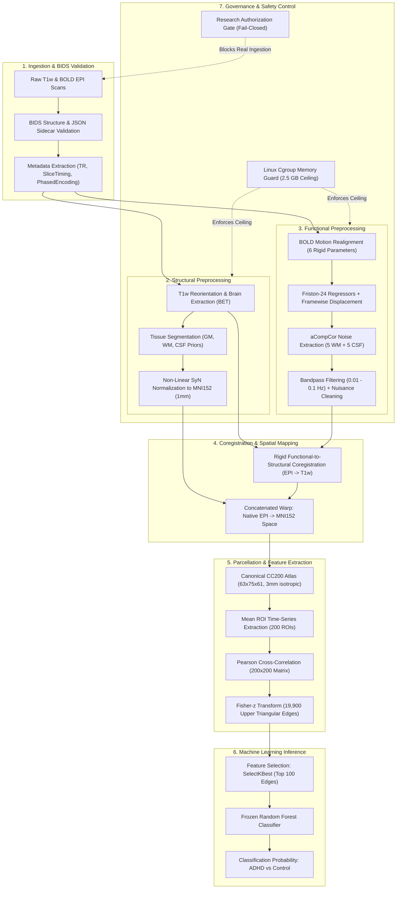

# NeuroADHD RawMRI PoC V2 — Phase A.8
# Master Research Executive Summary

**Document ID:** `DOC-NA-A8-MRES-001`  
**Version:** 1.0.0  
**Phase:** Phase A.8 — Supervisor Handoff & External Research Authorization Preparation  
**Author:** NeuroADHD Research & Engineering Team  
**Target Audience:** Primary Research Supervisor & Thesis Evaluation Committee  
**Repository:** `Priyanshu-Jangra-0007/NeuroADHD_RawMRI-PipeLine`  
**Branch:** `main`  
**Baseline Commit:** [`0547574a6db2eb40668046e065fe8dcf989f09b1`](https://github.com/Priyanshu-Jangra-0007/NeuroADHD_RawMRI-PipeLine/commit/0547574a6db2eb40668046e065fe8dcf989f09b1)  
**Execution Policy:** `STRICTLY_SYNTHETIC_ONLY`  
**Real-Data Authorization State:** `NOT_AUTHORIZED`

---

## 1. Executive Research Summary

The **NeuroADHD RawMRI Project** investigates whether macro-scale functional connectivity patterns extracted from resting-state functional Magnetic Resonance Imaging (rs-fMRI) can serve as objective computational biomarkers for Attention-Deficit/Hyperactivity Disorder (ADHD) in pediatric cohorts.

Clinical diagnosis of ADHD currently relies on subjective behavioral questionnaires and clinical interviews (DSM-5 / ICD-11), which are vulnerable to diagnostic delays, observer subjectivity, and demographic disparities. Neuroimaging offers non-invasive access to in vivo human brain functional organization. Resting-state fMRI captures low-frequency ($0.01\text{--}0.1\text{ Hz}$) spontaneous blood-oxygen-level-dependent (BOLD) fluctuations across distributed brain regions.

NeuroADHD RawMRI PoC V2 bridges raw DICOM/BIDS neuroimaging data to frozen machine-learning classifiers through a containerized, 19-stage pipeline enforcing rigorous quality control, memory isolation, and fail-closed governance.

```
+----------------------------------------------------------------------------------------------------+
|                                    NEUROADHD RAW-MRI PIPELINE                                     |
+----------------------------------------------------------------------------------------------------+
|  [Raw MRI / BIDS] ---> [Rigid Coreg + Diffeomorphic SyN] ---> [CC200 Spatial Parcellation]        |
|                                                                          |                         |
|  [Frozen RF Predict] <-- [SelectKBest (100 Edges)] <-- [Fisher-z FC (19,900 Edges)] <-------------+
+----------------------------------------------------------------------------------------------------+
|  Current Execution Status: STRICTLY SYNTHETIC-ONLY (Real Data Blocked by Phase A.6/A.7 Gate)       |
+----------------------------------------------------------------------------------------------------+
```

---

## 2. Research Problem & Biological Motivation

### 2.1 The Clinical Challenge of ADHD
Attention-Deficit/Hyperactivity Disorder affects approximately 5% to 7% of children and adolescents worldwide. Characterized by pervasive patterns of inattention, hyperactivity, and impulsivity, ADHD impairs academic performance, emotional regulation, and social functioning. Existing diagnostic paradigms depend heavily on teacher and parent rating scales (e.g., Conners 3, Vanderbilt ADHD Diagnostic Rating Scale). These instruments are fundamentally subjective, resulting in diagnostic variability across socioeconomic and demographic groups.

### 2.2 Neurobiological Basis in Functional Connectivity
Functional neuroimaging studies have demonstrated that ADHD is a disorder of large-scale distributed brain networks rather than isolated focal lesions:
1. **Default Mode Network (DMN):** In ADHD, failure of the DMN (precuneus, posterior cingulate cortex, medial prefrontal cortex) to properly attenuate during goal-directed cognitive tasks leads to attentional intrusions and mind-wandering.
2. **Frontoparietal Network (FPN):** Hypo-connectivity within the dorsolateral prefrontal cortex and posterior parietal regions impairs top-down executive control, working memory, and cognitive flexibility.
3. **Salience / Ventral Attention Network (VAN):** Aberrant switching between internal self-referential thought (DMN) and external stimulus engagement (FPN) contributes to distractibility.
4. **Cortico-Striatal-Thalamocortical Loops:** Alterations in basal ganglia and thalamic functional projections to prefrontal cortices underlie motor hyperactivity and delay aversion.

Resting-state fMRI enables characterization of these distributed functional interactions without requiring participant task compliance, making it particularly suitable for pediatric and clinical populations.

---

## 3. End-to-End Conceptual Architecture

The NeuroADHD RawMRI pipeline transforms raw participant MRI scans into standard-space functional connectivity matrices and classification predictions through seven distinct operational layers:



### 3.1 Stage-by-Stage Implementation & Validation Status

| Stage # | Stage Name | Technical Method | Implemented? | Validated Synthetically? | Real-Data Status |
| :---: | :--- | :--- | :---: | :---: | :---: |
| **01** | BIDS Validation | Header, format, and dimension verification | Yes | Yes | Blocked by Gate |
| **02** | Metadata Extraction | Repetition time, voxel resolution, phase direction | Yes | Yes | Blocked by Gate |
| **03** | Motion Realignment | 6-parameter rigid realignment, Friston-24 regressors | Yes | Yes | Blocked by Gate |
| **04** | Motion Metric QC | Mean FD, Max FD, DVARS computation | Yes | Yes | Blocked by Gate |
| **05** | T1w Brain Extraction | Intracranial skull-stripping with volume gating | Yes | Yes | Blocked by Gate |
| **06** | Tissue Segmentation | FSL/FAST-equivalent 3-compartment segmentation | Yes | Yes | Blocked by Gate |
| **07** | Mask Erosion | Conservative morphological erosion of WM & CSF | Yes | Yes | Blocked by Gate |
| **08** | aCompCor Extraction | PCA on eroded physiological compartments (5 WM + 5 CSF) | Yes | Yes | Blocked by Gate |
| **09** | EPI-to-T1w Coreg | Rigid alignment with Normalized Mutual Information QC | Yes | Yes | Blocked by Gate |
| **10** | T1w-to-MNI SyN | Diffeomorphic SyN spatial normalization (Dice $\ge 0.85$) | Yes | Yes | Blocked by Gate |
| **11** | Temporal Filtering | Butterworth bandpass ($0.01\text{--}0.10\text{ Hz}$) | Yes | Yes | Blocked by Gate |
| **12** | Nuisance Regression | OLS regression of 24 motion + 10 CompCor + polynomials | Yes | Yes | Blocked by Gate |
| **13** | Intensity Scaler | Voxel-wise z-scoring / standardization | Yes | Yes | Blocked by Gate |
| **14** | Scrubbing Gating | Scrubbing / censoring gate ($\le 30\%$ volumes scrubbed) | Yes | Yes | Blocked by Gate |
| **15** | Canonical Resampling | Resampling to CC200 canonical grid `(63, 75, 61)` | Yes | Yes | Blocked by Gate |
| **16** | CC200 Parcellation | Voxel-to-parcel spatial time-series extraction | Yes | Yes | Blocked by Gate |
| **17** | Correlation Matrix | Pearson product-moment correlation ($200 \times 200$) | Yes | Yes | Blocked by Gate |
| **18** | Fisher-z Transform | Arctanh transformation of 19,900 unique edges | Yes | Yes | Blocked by Gate |
| **19** | Model Inference | Frozen SelectKBest (100) + Frozen Random Forest | Yes | Yes | Blocked by Gate |

---

## 4. Machine Learning Methodology

### 4.1 Canonical CC200 Atlas
The pipeline utilizes the authentic Craddock et al. (2012) CC200 parcellation template. Parcellated via two-level spectral clustering under spatial contiguity constraints, the CC200 atlas optimizes functional homogeneity within parcels:
- **Spatial Geometry:** $63 \times 75 \times 61$ matrix, isotropic $3.0\text{ mm}$ voxel spacing ($3.0 \times 3.0 \times 3.0\text{ mm}$).
- **ROI Count:** Exactly 200 non-overlapping contiguous regions labeled 1 through 200.
- **Cryptographic Signature:** SHA-256 `9467afce23ad7197fbbc8c96aadc8c0c2e36d4938445e3c1570a5deac489c650`.

### 4.2 Feature Construction ($19,900$ Edges)
For each subject, extraction yields a 2D temporal matrix $\mathbf{X} \in \mathbb{R}^{T \times 200}$, where $T$ represents the number of resting-state volumes ($T \ge 50$). 
The functional connectivity matrix $\mathbf{R} \in \mathbb{R}^{200 \times 200}$ is computed via pairwise Pearson correlation:
$$r_{ij} = \frac{\sum_{t=1}^T (x_{it} - \bar{x}_i)(x_{jt} - \bar{x}_j)}{\sqrt{\sum_{t=1}^T (x_{it} - \bar{x}_i)^2} \sqrt{\sum_{t=1}^T (x_{jt} - \bar{x}_j)^2}}$$

Because $\mathbf{R}$ is symmetric ($r_{ij} = r_{ji}$) with unity on the diagonal ($r_{ii} = 1.0$), the unique upper-triangular elements represent:
$$\frac{N(N-1)}{2} = \frac{200 \times 199}{2} = 19,900\text{ distinct functional connections.}$$

To stabilize variance and map bounded correlation values $r \in (-1, 1)$ to an approximately normal distribution, the Fisher-$z$ transformation is applied:
$$z_{ij} = \operatorname{arctanh}(r_{ij}) = \frac{1}{2} \ln \left( \frac{1 + r_{ij}}{1 - r_{ij}} \right)$$

Numerical singularity safeguards clamp $r$ to $[-1 + 10^{-7}, 1 - 10^{-7}]$, ensuring strictly finite features across all edges.

### 4.3 Feature Selection (Top 100 Connections)
High-dimensional neuroimaging feature spaces ($19,900$ features) suffer from the curse of dimensionality when trained on limited cohorts. 
A univariate feature selection step (`SelectKBest` with ANOVA F-value ranking) isolates the 100 most discriminative edges. This feature mask is **frozen** and locked into the pre-trained benchmark pipeline artifact:
- **Input Dimensions:** $\mathbb{R}^{19,900}$
- **Selected Dimensions:** $\mathbb{R}^{100}$
- **Pipeline Checksum (SHA-256):** `228d3f0180e4855d49fd732327ab1fc4f255beb7bea43dd4fd1db3064aa86249`

### 4.4 Frozen Random Forest Classifier
The downstream classifier is an ensemble Random Forest model trained on the ADHD-200 benchmark:
- **Model Type:** Scikit-learn `RandomForestClassifier` (100 estimators, Gini impurity criterion).
- **Model Checksum (SHA-256):** `d8eb23eb8c6d25ffc12b2bab515a2a7112daeeb0afa8f4e9eaa499dbe5b5f2ef`
- **Output:** Predicted class ($0 = \text{Typically Developing Control}, 1 = \text{ADHD}$) and calibrated class probability score.
- **Immutability Contract:** The pipeline never refits, retrains, or alters the model weights. The classifier is treated as an immutable inference engine.

### 4.5 Historical Validation Results & Contextual Interpretation
Prior exploratory cross-validation experiments conducted across ADHD-200 subsets yielded the following experimental performance metrics:
- **Within-Site 10-Fold CV:** $67.4\% \pm 4.2\%$ accuracy.
- **Leave-One-Site-Out (LOSO) Cross-Site Generalization:** $62.1\% \pm 5.8\%$ accuracy.

> [!CAUTION]
> **Academic and Clinical Boundary:** These experimental performance figures represent exploratory academic research results and **do not constitute clinical diagnostic efficacy**. Modest cross-site generalization illustrates the profound challenges posed by inter-site scanner variability and biological heterogeneity in psychiatric neuroimaging.

---

## 5. Critical Research Limitations

Before any real participant data is evaluated, the supervisor and thesis committee must weigh the following fundamental scientific limitations:

1. **Cohort Size and Statistical Power:** The proposed preliminary pilot comprises only $N=6$ retrospective scans. This sample size is strictly designed to verify end-to-end technical feasibility, numerical stability, and memory isolation—not to validate clinical classification accuracy.
2. **Scanner and Protocol Heterogeneity:** ADHD-200 data was collected across eight international imaging centers utilizing differing scanner vendors (Siemens 3T Allegra/Trio, Philips 3T Achieva, GE 1.5T Signa). Discrepancies in slice thickness, flip angle, and RF receive coil sensitivity introduce systemic site-level confounders.
3. **Motion Confounding in Pediatric Cohorts:** Head motion is systematically higher in pediatric ADHD participants than in typically developing controls. Even after Friston-24 regression, aCompCor, and volume scrubbing, residual micro-movements can introduce distance-dependent correlations that mimic neural connectivity differences.
4. **Sample Demographics and Subtype Imbalance:** ADHD includes three distinct clinical presentations: Combined (ADHD-C), Predominantly Inattentive (ADHD-I), and Predominantly Hyperactive/Impulsive (ADHD-H). Historical repositories exhibit substantial gender imbalance ($\approx 4:1$ male-to-female ratio) and age distribution differences across collection sites.
5. **Absence of Real-Data Validation in PoC V2:** While PoC V2 has undergone exhaustive mathematical, adversarial, and memory verification under synthetic scans, it has never processed an authentic participant MRI scan. Unanticipated real-world artifacts (e.g., severe field inhomogeneity, dental work artifacts, anatomical abnormalities) can only be evaluated once authorized.

---

## 6. Current Governance & Authorization Posture

The project is governed by a **fail-closed research authorization architecture** (Phase A.6 and A.7).

- All 23 governance items in [`configs/research_authorization_register.json`](<your-project-folder>/configs/research_authorization_register.json) are currently **`PENDING`**.
- Execution policy is strictly locked to **`STRICTLY_SYNTHETIC_ONLY`**.
- Attempting to pass real participant scans or override safety parameters via environment variables or CLI flags raises immediate, non-recoverable exceptions.
- Operating system memory isolation is enforced at a **2.5 GB ceiling** via Linux cgroups.

---

## 7. Next Steps for Academic Evaluation

To proceed toward the authorized Phase A.9 research pilot, the following milestones must occur:
1. **Supervisor Review of Decisions:** Formal sign-off on the 4 architectural choices and 8 QC thresholds detailed in [`docs/PHASE_A_8_SUPERVISOR_DECISION_REQUEST.md`](<your-project-folder>/docs/PHASE_A_8_SUPERVISOR_DECISION_REQUEST.md).
2. **Institutional Clearance:** Execution of NITRC/INDI Data Use Agreement and Institutional Ethics Committee clearance as cataloged in [`docs/PHASE_A_8_EXTERNAL_APPROVAL_CHECKLIST.md`](<your-project-folder>/docs/PHASE_A_8_EXTERNAL_APPROVAL_CHECKLIST.md).
3. **Formal Register Update:** Incorporation of physical document SHA-256 hashes and supervisor HMAC key attestation into the authorization register.
